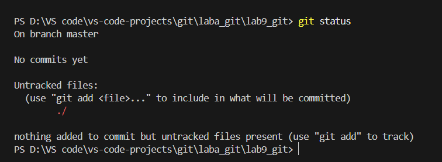
проверили текущую ветку и находимся на ветке master,  коммитов еще нет
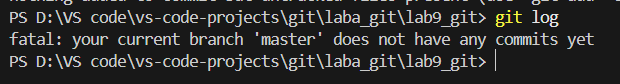
проверил журнал коммитов и так как ни одного коммита в репозитории не создано, git выводит сообщение об отсутствии истории в ветке master
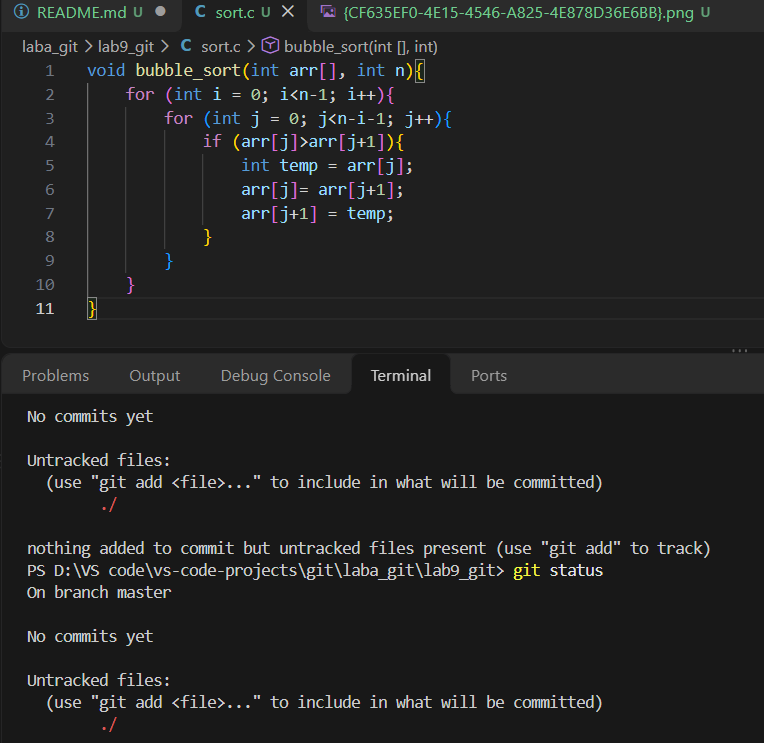
Создал файл sort.c с функцией сортировки пузырьком. команда git status показывает, что в текущей папке появились неотслеживаемые файлы untracked files, которые ещё не добавлены в индекс git
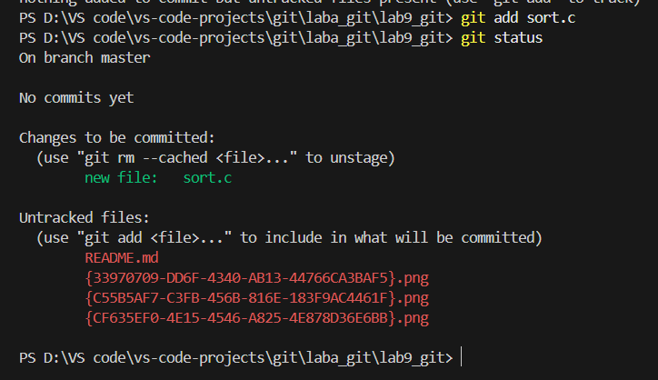
он написан зеленым цветом, готов к сохранению
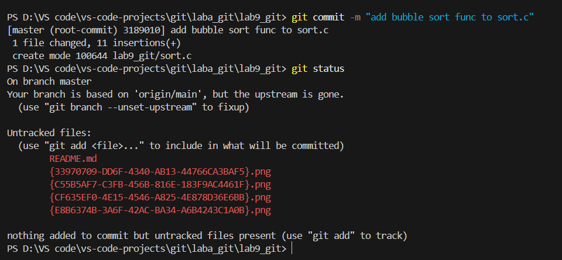
файл sort.c пропал из списка изменений, он сохранен в истории
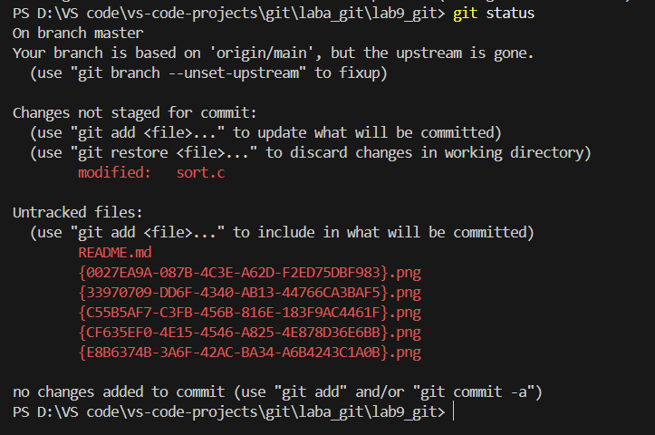
после добавление комментария Git заметил правку и пометил файл красным как изменённый, но ещё не добавленный в индекс
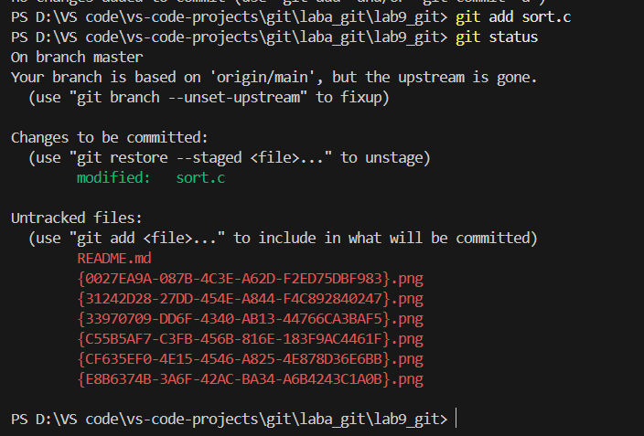
снова зеленый, midified 
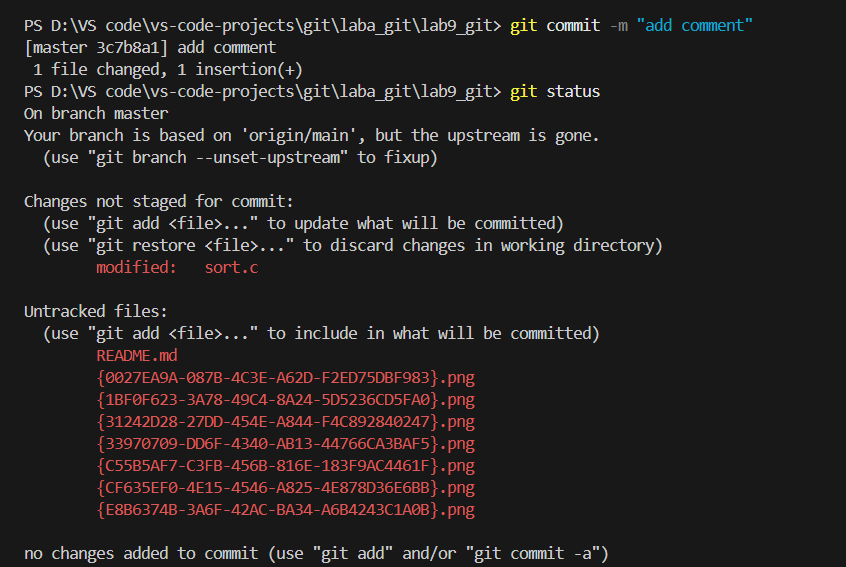
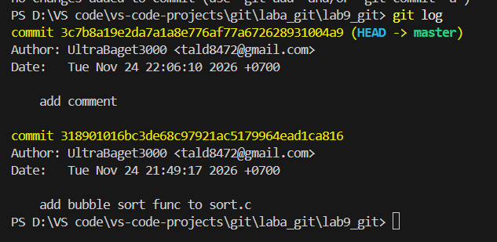
Проверил журнал командой, в истории отображаются два коммита - это добавление функции сортировки 'add bubble sort func to sort.c' и добавление первого комментария 'add comment', на который указывает ветка master
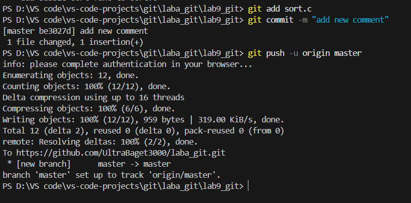
добавил оставшиеся изменения в sort.c в индекс, зафиксировал коммитом и отправил локальные ветки master в удаленный репозиторий на github

//ветки

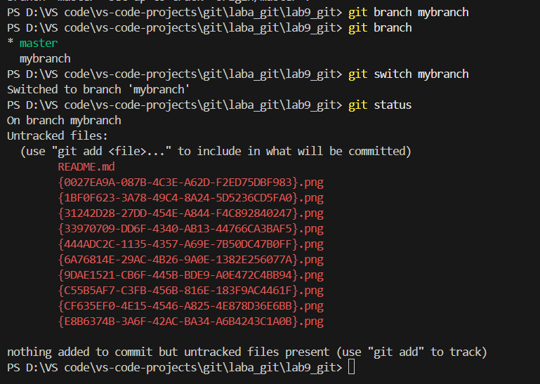
создание новой ветки mybranch и проверка списока веток, затем переключение на неё. в выводе первая строка изменилась с on branch master на on branch mybranch, подтвердившая переход в новую ветку
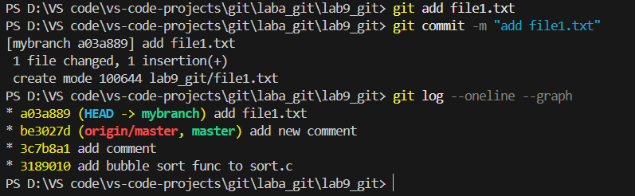
добавление файла file1.txt со своим именем в индекс и закоммитил в ветку mybranch. вывод показывает, что ветка mybranch продвинулась на новый коммит вперёд относительно ветки master
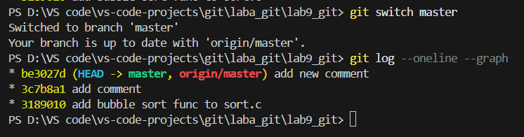
переключились обратно на ветку master и проверили граф коммитов. последний коммит с файлом file1.txt отсутствует, так как он остался в истории параллельной ветки mybranch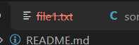
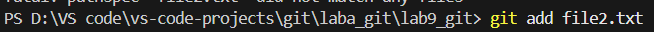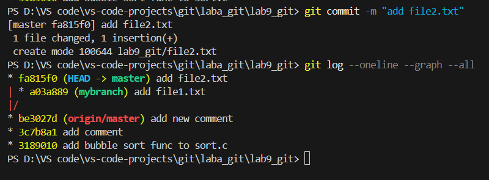
создание файла file2.txt в ветке master и фиксирование его коммитом. Команда git log --oneline --graph --all показала разветвление истории: ветки master и mybranch теперь указывают на разные последние коммиты
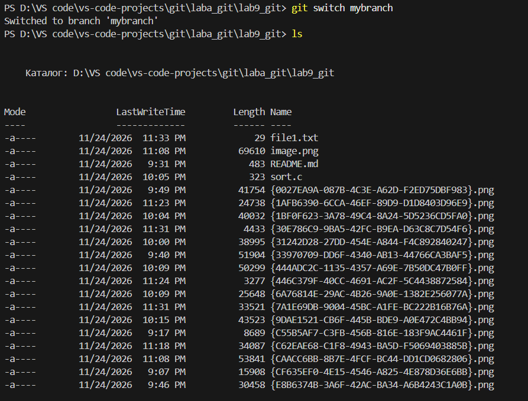 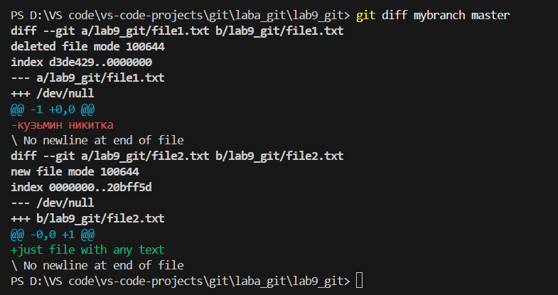
переключились на ветку mybranch и файл file2.txt тут нет, так как есть только в master, зато тут есть file2.txt. команда diff mybranch master показала разницу 
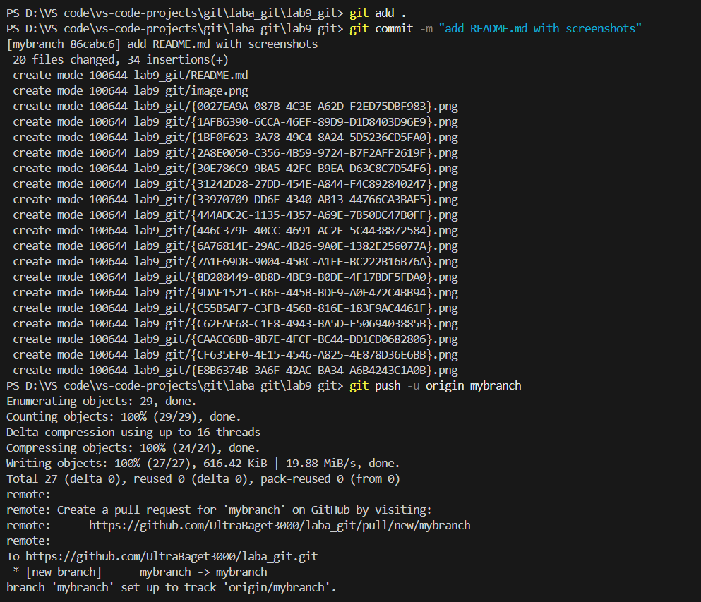
Добавление файл отчета README.md вместе со скриншотами, зафиксировал коммитом и отправил ветку mybranch на gitHub командой git push -u origin mybranch